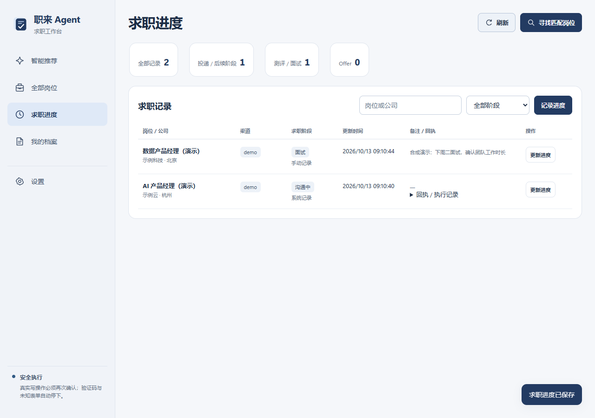
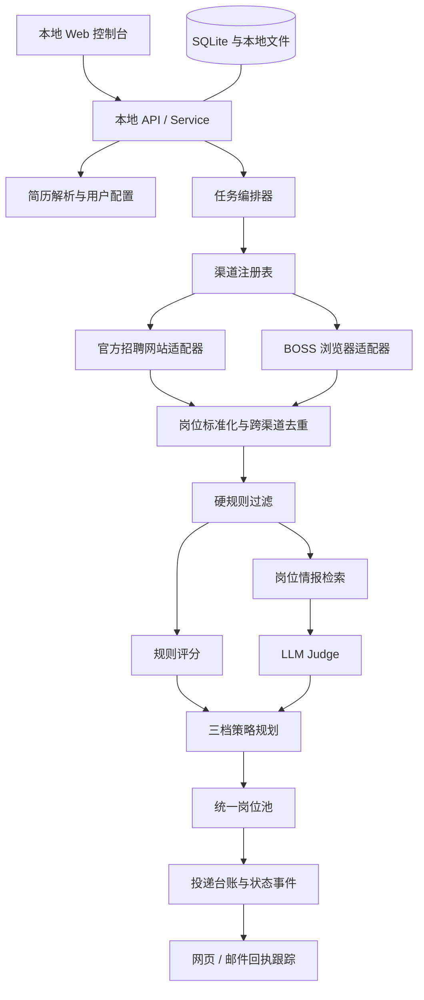

# 职来 Agent

## 项目简介

职来 Agent 是一个本地优先的求职工具，帮助校招、社招求职者整理跨渠道岗位，比较是否值得投，并跟踪投递进度。

默认智能推荐页展示高推荐工作卡；想自行搜索更多机会，可以进入全部岗位。推荐理由与风险保留来源依据，投递后的阶段在求职进度中维护。


[下载 Windows 便携版](https://github.com/dailaor/job-agent/releases/tag/v0.3.0-alpha) · [查看项目需求](docs/REQUIREMENTS.md) · [查看技术架构](docs/ARCHITECTURE.md)

截图使用明确标注的合成演示公司与岗位，不代表真实招聘或薪酬承诺。

## 核心功能

### 智能推荐工作卡

先看待遇与门槛，再比较推荐理由和风险，最后沿依据核对信息。卡片把以下决策点放在一起：

| 决策点 | 卡片如何呈现 |
|---|---|
| 能不能投 | 当前档案与已知学历、经验等门槛核对；“优先”与硬要求分开，未验证的提交资格明确保留 |
| 能力是否相关 | 显示技能关联与档案尚未体现的缺口，不把技能覆盖当作录用概率 |
| 待遇值不值得 | 展示已披露区间及日/月/年口径；发薪月数、奖金、股权、福利等可展开核对 |
| 工作体验如何 | 时间负担、工作节奏、职责质量、管理文化、成长性、稳定性六组固定展示 |
| 为什么推荐 | 每条理由与风险关联可回查依据；多来源合并成一个入口，展开后定位所有关联来源 |
| 下一步做什么 | 阅读待向 HR 确认的问题，再打开原岗位；完整岗位池仍保留全部机会 |

点击“依据”，查看原文、来源链接、日期和适用范围。同公司但团队或城市未对齐的经历只作背景参考；缺少可信数据时显示待核实，不补造薪资、工时、总包，也不承诺招聘系统一定允许提交。否定描述、冲突或已失效证据不作为可靠正向支持。

查看、搜索和切换推荐卡使用当前本机档案与有效证据，不自动调用付费模型；获取新岗位和可选评分由用户主动发起。一键投递目前未开放。

<details>
<summary>查看移动端工作卡</summary>


</details>

### 功能总览

| 能力 | 说明 | 当前状态 |
|---|---|---|
| 智能推荐工作卡 | 高推荐岗位单卡浏览、左右切换与依据展开 | 已实现 |
| PDF/DOCX 简历 | 上传并解析简历，再次使用时可以沿用，也可以重新上传覆盖旧简历 | 已实现 |
| 硬规则筛选 | 支持岗位名称、地点、用工类型、办公方式、最低薪资、经验差距、发布时间、排除词和公司黑名单 | 已实现 |
| 五个官网岗位采集 | 从美团、滴滴、快手、腾讯和京东校园招聘官网采集公开岗位 | 已实现 |
| 跨渠道去重 | 将不同渠道的岗位标准化，根据公司、岗位、地点等信息识别重复记录 | 已实现 |
| 双向评分 | 分别判断“候选人是否匹配岗位”和“岗位是否满足候选人需求” | 已实现 |
| 三档岗位推荐 | 根据用户策略和双向评分，将岗位分为冲高、持平和保底 | 已实现 |
| 求职进度 | 维护阶段与备注，兼容历史执行记录和回执 | 已实现 |
| LLM Judge | 通过可插拔评分接口接入大模型，对简历、JD 和岗位证据进行结构化判断 | 已实现，可选启用 |
| 岗位情报 RAG | 检索 JD 之外的岗位要求与工作体验，为双向判断补充可追溯证据 | 已实现，持续完善 |
| BOSS 浏览器流程 | 读取岗位和沟通状态，遇登录失效、验证码或页面变化时转人工 | 实验能力 |
| 邮件回执跟踪 | 根据公司、岗位和回执关键词核对申请成功或拒绝结果 | 实验能力 |
| 浏览器插件自动填表 | 复用用户确认过的结构化信息，辅助填写基础表单 | 规划中 |
| 真实用户反馈校准 | 根据保存、投递、纠正原因与后续结果校准推荐 | 规划中 |
| 属性级 RAG | 分别围绕薪资、工时、成长、文化、稳定性检索证据 | 规划中 |

## 快速开始

### Windows 便携版

从 [Releases](https://github.com/dailaor/job-agent/releases/tag/v0.3.0-alpha) 下载 Windows x64 ZIP，解压后运行 `JobAgent.exe`。程序会打开本地控制台，配置、简历、岗位和进度保存在 EXE 旁的 `data/` 中。Actions 构建产物仍可作为维护者测试包。

首次使用上传简历并核对条件；再次使用可以沿用。需要保留既有数据时，先退出旧程序、备份原 `data/`，再放到新 `JobAgent.exe` 旁边；若提示简历路径失效，在我的档案重新上传。

<details>
<summary>从源码运行</summary>

```powershell
py -3.13 -m venv .venv
.\.venv\Scripts\python.exe -m pip install -e .
.\.venv\Scripts\job-agent.exe init
.\.venv\Scripts\job-agent.exe serve
```

打开 `http://127.0.0.1:8765` 即可进入本地控制台。

</details>

## 使用流程与页面分工

日常可以直接浏览已有推荐；需要获取新岗位时，点击“寻找匹配岗位”进入向导。


### 各页面做什么

| 页面 | 什么时候进入 | 你可以做什么 |
|---|---|---|
| 智能推荐 | 查看重点机会时 | 左右切换高推荐卡，比较理由与风险，点击依据核对来源 |
| 全部岗位 | 自行搜索或扩大选择时 | 搜索全部推荐度的岗位，按状态筛选，查看原岗位并记录进度 |
| 求职进度 | 准备投递或跟进时 | 维护当前阶段、备注与更新时间，查看历史记录和回执 |
| 我的档案 | 首次使用或条件变化时 | 核对简历、学历、年限与技能，调整岗位、地点、待遇和体验偏好 |
| 设置 | 配置来源或维护渠道时 | 启用渠道、调整关键词与固定答案；高级区保留情报库、统计、运行记录和实验工具 |

### 1. 沿用或替换简历

上传 PDF 或 DOCX，或沿用当前简历；解析不完整时在我的档案校正。


### 2. 填写岗位条件并选择渠道

填写岗位方向和地点，按需展开更多条件；选择冲刺、均衡或保底策略，再勾选本次已就绪的渠道。


### 3. 获取岗位，比较推荐依据

开始获取后，各渠道独立返回结果，单个渠道失败不抹掉其他结果。完成后查看智能推荐；想搜索更多岗位或查看不同推荐度，进入全部岗位。


### 4. 查看原岗位并记录进度

核实待确认的信息，打开原岗位完成实际投递，再通过“记录求职进度”保存后续阶段与备注。

求职进度支持准备投递、沟通中、提交待确认、已投递、测评、面试、Offer、已结束八个阶段。手动记录只保存本机信息，不向招聘平台发送消息或提交申请。



## 实现机制

### 官网岗位渠道

项目通过独立适配器处理不同招聘官网的协议差异，再将结果转换为统一岗位结构。

| 渠道 | 采集方式 |
|---|---|
| 美团校招 | 官方公开岗位接口 |
| 滴滴校招 | Moka 岗位接口、会话初始化与响应解密 |
| 快手校招 | 官方公开岗位接口 |
| 腾讯校招 | 官方搜索接口与岗位详情接口 |
| 京东校招 | 官方公开岗位接口 |

渠道采用注册表方式管理。新增渠道时，只需实现对应适配器并注册，无需修改岗位过滤、评分、推荐和台账主流程。

### 双向岗位评估

职来 Agent 不使用单一综合分直接决定是否推荐岗位，而是将判断拆成两个方向。

#### 候选人是否匹配岗位

主要判断：

- 技能和岗位要求的覆盖程度；
- 工作或项目经验与岗位职责的关联性；
- 经验年限和岗位门槛之间的差距；
- 候选人的能力是否能够迁移到目标岗位。

#### 岗位是否满足候选人

主要判断：

- 薪资是否达到最低期望；
- 工作地点和办公方式是否可接受；
- 工作强度是否符合个人取向；
- 职责边界、成长空间、团队文化和稳定性是否符合需求。

冲刺、均衡和保底策略会调整两个方向的权重，并影响冲高、持平、保底岗位在最终推荐清单中的比例。

### 岗位情报 RAG

岗位 JD 通常能够说明职责和基础要求，但不一定完整披露真实面试门槛、工作强度、薪酬结构、团队文化和成长空间。岗位情报 RAG 用于补足这些信息，辅助模型进行更有依据的岗位判断。

<details>
<summary>查看开发样本与检索流程</summary>

开发样本库包含：

- 50 篇经过准入检查的岗位经历；
- 147 个可检索的岗位证据块；
- 覆盖腾讯、阿里、美团、快手和百度；
- 覆盖产品、数据、算法和后端岗位族，目前以后端和算法内容为主；
- 正职和实习分别存储、分别检索，避免不同用工类型的信息混用；
- 证据主题包括职责、技能、面试、工作强度、薪酬、文化、成长、稳定性和办公方式。

处理流程如下：

```text
可追溯岗位经历
    ↓
来源、公司、岗位、时效和内容准入检查
    ↓
脱敏、去重并建立父文档
    ↓
按决策主题切分证据块
    ↓
Hashing 向量 + BM25 混合检索
    ↓
生成“能力匹配”和“岗位需求”两路证据
    ↓
交给 LLM Judge 辅助决策并保留来源
```

能力侧主要使用职责、技能和面试证据，补充岗位真实关注的能力要求；岗位需求侧主要使用薪资、工时、成长、文化和稳定性证据，补充 JD 没有完整披露的岗位体验。

RAG 提供的是辅助证据，不会覆盖地点、学历、薪资下限等确定性硬规则。

开发样本反映本机语料，公共仓库和发布包不附带这份私人情报库。

</details>

### 技术架构

<details>
<summary>查看架构图与主要技术组件</summary>



#### 主要技术组件

- **前端：** 原生 HTML、CSS 和 JavaScript；
- **后端：** Python 本地服务与任务编排；
- **数据存储：** SQLite、本地简历和配置文件；
- **岗位采集：** 渠道注册表、官方招聘网站适配器和可选 Playwright 浏览器适配器；
- **岗位决策：** 硬规则、双向评分、LLM Judge 和策略规划器；
- **知识检索：** 父子文档、Hashing 向量与 BM25 混合检索；
- **模型接入：** 可替换的 ScoringPort，支持用户配置 API；
- **本地发布：** PyInstaller Windows 便携包；
- **安全边界：** 不绕过验证码、不索取账号密码，最终投递保留用户确认。

</details>

## 项目文档与许可

- [产品需求文档](docs/REQUIREMENTS.md)
- [技术架构](docs/ARCHITECTURE.md)
- [维护手册](docs/MAINTENANCE.md)
- [渠道适配指南](docs/CHANNEL_ADAPTERS.md)
- [硬筛选字段说明](docs/HARD_FILTERS.md)
- [贡献指南](CONTRIBUTING.md)

[MIT License](LICENSE)
