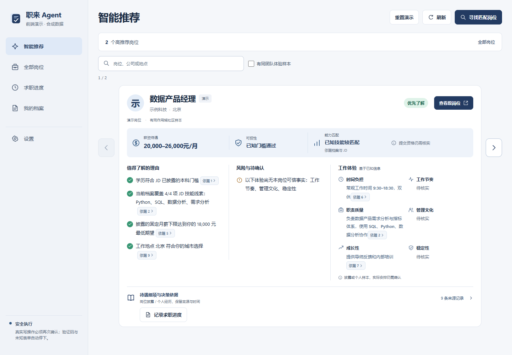
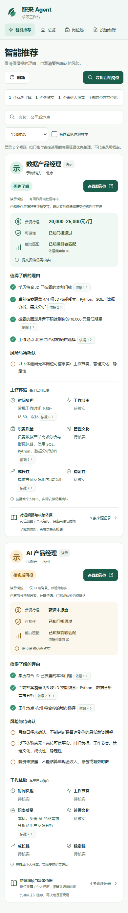
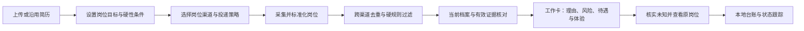
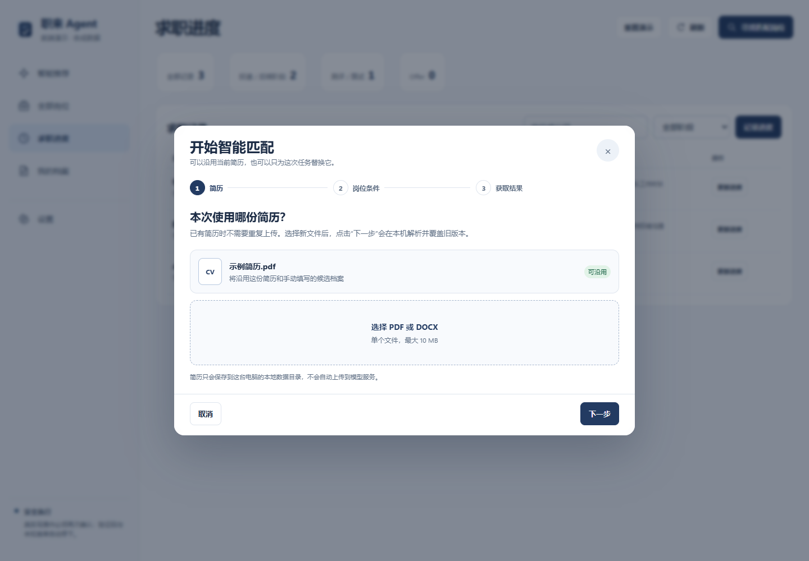
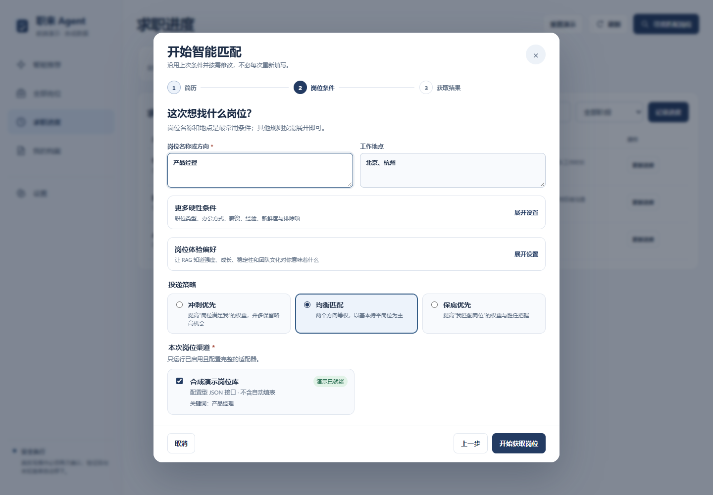
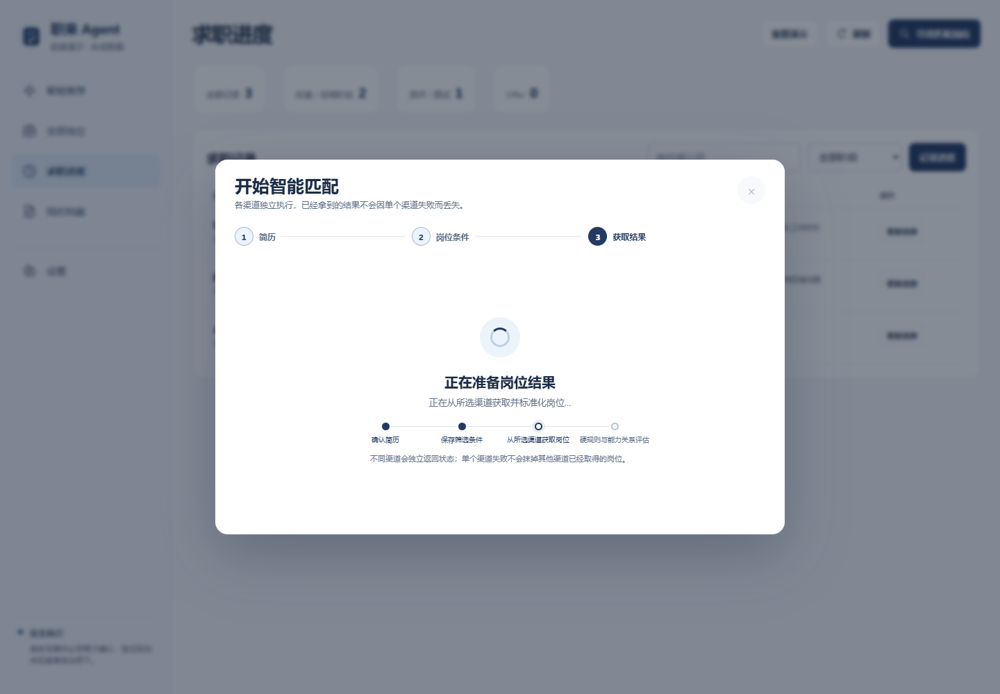
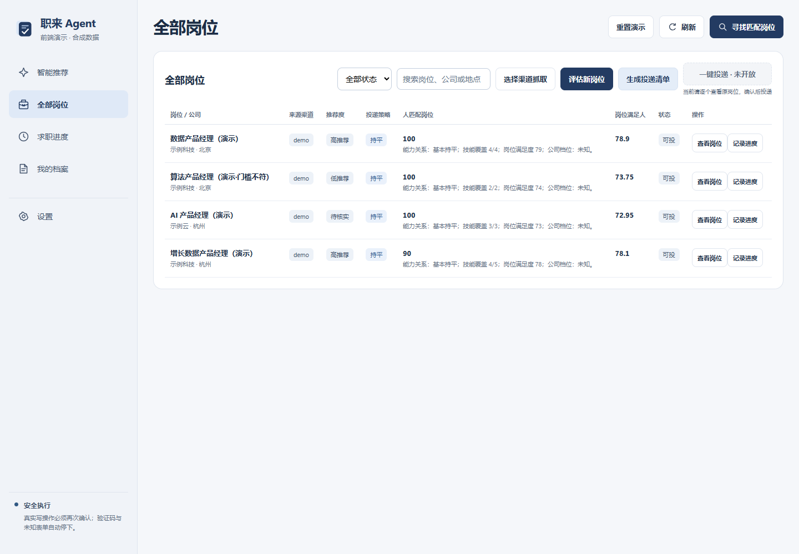
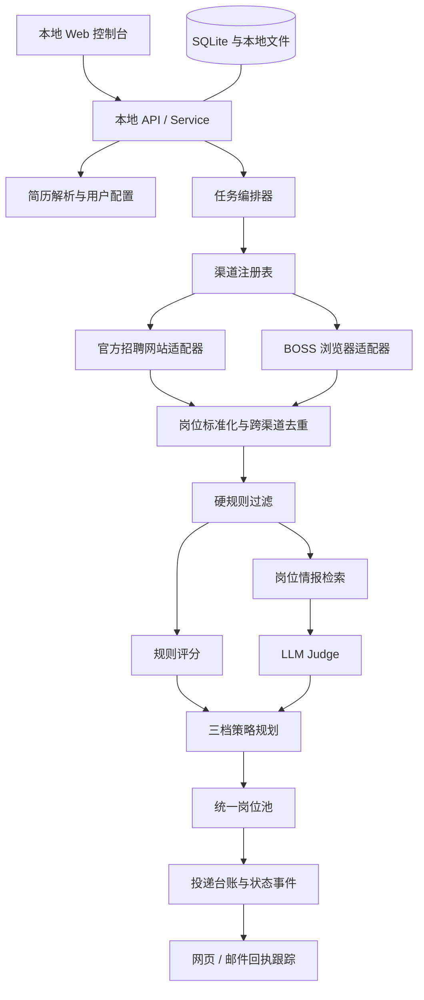

# 职来 Agent

> 让每一次投递都更值得。

职来 Agent 是一个本地优先的智能求职 Agent，面向校招、社招等需要集中发现、筛选和管理岗位的求职场景。

项目关注的不是替用户批量海投，而是降低求职过程中三类重复成本：

- 在多个招聘渠道中反复搜索和整理岗位；
- 判断自己是否胜任岗位，以及岗位是否符合个人需求；
- 重复填写申请信息，并持续跟踪投递、测评和面试状态。

系统从用户档案和目标出发，整理已适配渠道的岗位。默认智能推荐页用工作卡展示可投门槛、能力、薪资待遇、六组工作体验、值得了解的理由和风险，并把结论链接到来源证据。完整岗位池、已有双向评估和投递台账保持独立入口。



[下载最新 Windows 便携版](https://github.com/dailaor/job-agent/releases/tag/v0.2.1-alpha) · [查看项目需求](docs/REQUIREMENTS.md) · [查看技术架构](docs/ARCHITECTURE.md)

## 智能推荐工作卡

一份工作值得不值得投，不能只靠岗位名和一个综合分。智能推荐把用户实际决策需要的信息放在同一张工作卡中：先看待遇与门槛，再比较值得了解的理由和风险，最后沿证据核实。

| 决策点 | 卡片如何呈现 |
|---|---|
| 能不能投 | 当前档案与已知学历、经验等门槛核对；“优先”与硬要求分开，未验证的提交资格明确保留 |
| 能力是否相关 | 显示技能关联与档案尚未体现的缺口，不把技能覆盖当作录用概率 |
| 待遇值不值得 | 展示已披露区间及日/月/年口径；发薪月数、奖金、股权、福利等可展开核对 |
| 工作体验如何 | 时间负担、工作节奏、职责质量、管理文化、成长性、稳定性六组固定展示 |
| 为什么推荐 | 每条理由与风险关联可回查依据；多来源合并成一个入口，展开后定位所有关联来源 |
| 下一步做什么 | 阅读待向 HR 确认的问题，再打开原岗位；完整岗位池仍保留全部机会 |

点击卡片中的“依据”即可展开并聚焦原文、来源链接、日期与适用范围。同公司但团队或城市未对齐的经历只作背景参考；没有可信数据的薪资、工时、成长等显示“待核实”，不补造总包、不承诺 ATS 一定能提交。否定描述、不同来源冲突与已失效证据不会被当作正向推荐支持。

推荐页采用浅色导航、薄荷绿/琥珀状态、横向工作卡和分区阅读，手机宽度会依序重排，决策信息不被裁切。README 截图来自实际运行页面，使用明确标注的合成演示公司与岗位，不代表真实招聘或薪酬承诺。

读取与筛选推荐使用当前本机档案和有效岗位证据，不自动调用付费模型。主动“寻找匹配岗位”仍走用户已配置的渠道与可选评分流程。岗位池的“一键投递”目前明确标为未开放，不发送或提交申请。

<details>
<summary>查看移动端工作卡</summary>



</details>

保留既有数据时，先备份原程序的 `data/`，再将其放在新解压目录的 `JobAgent.exe` 旁边。

## 使用流程



## 界面预览

智能推荐页为当前默认入口；以下为原有匹配和岗位管理流程。

### 1. 沿用或替换本地简历

支持 PDF 和 DOCX。用户再次使用时可以沿用当前简历，也可以只为本次任务替换它。



### 2. 设置岗位目标、策略与渠道

岗位名称和地点保持在主流程中，其他硬性条件按需展开；用户可以选择冲刺、均衡或保底策略，并决定本次运行哪些岗位渠道。



### 3. 获取并评估岗位

各渠道独立执行，已取得的结果不会因单个渠道失败而丢失。岗位完成标准化后进入硬规则和能力关系评估。



### 4. 查看统一岗位池

岗位池统一展示来源渠道、推荐策略、双向评分、过滤状态和原始岗位入口。



## 功能总览

| 能力 | 说明 | 当前状态 |
|---|---|---|
| 智能推荐工作卡 | 可投门槛、待遇、能力、理由/风险、六组体验、证据溯源；浅色商业工作台与响应式布局 | 已实现 |
| PDF/DOCX 简历 | 上传并解析简历，再次使用时可以沿用，也可以重新上传覆盖旧简历 | 已实现 |
| 硬规则筛选 | 支持岗位名称、地点、用工类型、办公方式、最低薪资、经验差距、发布时间、排除词和公司黑名单 | 已实现 |
| 五个官网岗位采集 | 从美团、滴滴、快手、腾讯和京东校园招聘官网采集公开岗位 | 已实现 |
| 跨渠道去重 | 将不同渠道的岗位标准化，根据公司、岗位、地点等信息识别重复记录 | 已实现 |
| 双向评分 | 分别判断“候选人是否匹配岗位”和“岗位是否满足候选人需求” | 已实现 |
| 三档岗位推荐 | 根据用户策略和双向评分，将岗位分为冲高、持平和保底 | 已实现 |
| 本地投递台账 | 保存岗位、评估结果、投递记录和状态事件，方便持续跟踪 | 已实现 |
| LLM Judge | 通过可插拔评分接口接入大模型，对简历、JD 和岗位证据进行结构化判断 | 已实现，可选启用 |
| 岗位情报 RAG | 检索 JD 之外的岗位要求与工作体验，为双向判断补充可追溯证据 | 已实现，持续完善 |
| BOSS 浏览器流程 | 通过浏览器读取岗位和沟通状态，登录失效、验证码或页面变化时停止并转人工 | 持续完善 |
| 邮件回执跟踪 | 根据公司、岗位、投递时间和邮件语义识别申请成功、测评、面试或拒绝事件 | 持续完善 |
| 浏览器插件自动填表 | 复用用户确认过的结构化个人信息，辅助填写招聘官网中的基础表单 | 持续完善 |
| 真实用户反馈校准 | 根据用户的保存、投递、跳过、纠正原因和后续面试结果持续校准推荐 | 持续完善 |
| 属性级 RAG | 分别围绕薪资、工时、成长、文化、稳定性等属性检索和输出证据 | 持续完善 |

## 官网岗位渠道

项目通过独立适配器处理不同招聘官网的协议差异，再将结果转换为统一岗位结构。

| 渠道 | 采集方式 |
|---|---|
| 美团校招 | 官方公开岗位接口 |
| 滴滴校招 | Moka 岗位接口、会话初始化与响应解密 |
| 快手校招 | 官方公开岗位接口 |
| 腾讯校招 | 官方搜索接口与岗位详情接口 |
| 京东校招 | 官方公开岗位接口 |

渠道采用注册表方式管理。新增渠道时，只需实现对应适配器并注册，无需修改岗位过滤、评分、推荐和台账主流程。

## 双向岗位评估

职来 Agent 不使用单一综合分直接决定是否推荐岗位，而是将判断拆成两个方向。

### 候选人是否匹配岗位

主要判断：

- 技能和岗位要求的覆盖程度；
- 工作或项目经验与岗位职责的关联性；
- 经验年限和岗位门槛之间的差距；
- 候选人的能力是否能够迁移到目标岗位。

### 岗位是否满足候选人

主要判断：

- 薪资是否达到最低期望；
- 工作地点和办公方式是否可接受；
- 工作强度是否符合个人取向；
- 职责边界、成长空间、团队文化和稳定性是否符合需求。

冲刺、均衡和保底策略会调整两个方向的权重，并影响冲高、持平、保底岗位在最终推荐清单中的比例。

## 岗位情报 RAG

岗位 JD 通常能够说明职责和基础要求，但不一定完整披露真实面试门槛、工作强度、薪酬结构、团队文化和成长空间。岗位情报 RAG 用于补足这些信息，辅助模型进行更有依据的岗位判断。

当前岗位情报库包含：

- 50 篇经过准入检查的岗位经历；
- 147 个可检索的岗位证据块；
- 覆盖腾讯、阿里、美团、快手和百度；
- 覆盖产品、数据、算法和后端岗位族，目前以后端和算法内容为主；
- 正职和实习分别存储、分别检索，避免不同用工类型的信息混用；
- 证据主题包括职责、技能、面试、工作强度、薪酬、文化、成长、稳定性和办公方式。

处理流程如下：

```text
可追溯岗位经历
    ↓
来源、公司、岗位、时效和内容准入检查
    ↓
脱敏、去重并建立父文档
    ↓
按决策主题切分证据块
    ↓
Hashing 向量 + BM25 混合检索
    ↓
生成“能力匹配”和“岗位需求”两路证据
    ↓
交给 LLM Judge 辅助决策并保留来源
```

能力侧主要使用职责、技能和面试证据，补充岗位真实关注的能力要求；岗位需求侧主要使用薪资、工时、成长、文化和稳定性证据，补充 JD 没有完整披露的岗位体验。

RAG 提供的是辅助证据，不会覆盖地点、学历、薪资下限等确定性硬规则。

## 技术架构



### 主要技术组件

- **前端：** 原生 HTML、CSS 和 JavaScript；
- **后端：** Python 本地服务与任务编排；
- **数据存储：** SQLite、本地简历和配置文件；
- **岗位采集：** 渠道注册表、官方招聘网站适配器和可选 Playwright 浏览器适配器；
- **岗位决策：** 硬规则、双向评分、LLM Judge 和策略规划器；
- **知识检索：** 父子文档、Hashing 向量与 BM25 混合检索；
- **模型接入：** 可替换的 ScoringPort，支持用户配置 API；
- **本地发布：** PyInstaller Windows 便携包；
- **安全边界：** 不绕过验证码、不索取账号密码，最终投递保留用户确认。

## 快速开始

### Windows 便携版

从 [Releases](https://github.com/dailaor/job-agent/releases) 下载最新 Windows x64 ZIP，解压后运行 `JobAgent.exe`。配置、简历、岗位和投递记录都会保存在程序旁的本地 `data/` 目录中。Actions 人工构建产物仍可作为维护者测试包。

### 从源码运行

```powershell
py -3.13 -m venv .venv
.\.venv\Scripts\python.exe -m pip install -e .
.\.venv\Scripts\job-agent.exe init
.\.venv\Scripts\job-agent.exe serve
```

打开 `http://127.0.0.1:8765` 即可进入本地控制台。

## 项目文档

- [产品需求文档](docs/REQUIREMENTS.md)
- [技术架构](docs/ARCHITECTURE.md)
- [维护手册](docs/MAINTENANCE.md)
- [渠道适配指南](docs/CHANNEL_ADAPTERS.md)
- [硬筛选字段说明](docs/HARD_FILTERS.md)
- [贡献指南](CONTRIBUTING.md)

## License

[MIT License](LICENSE)
