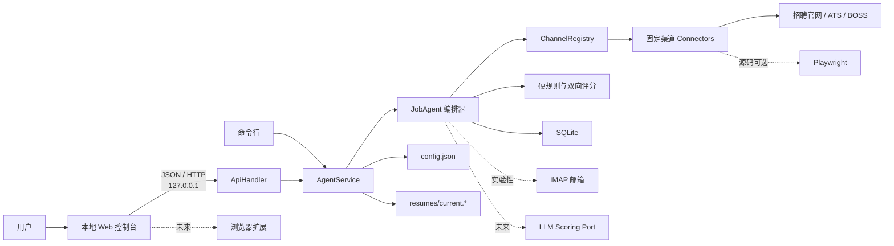
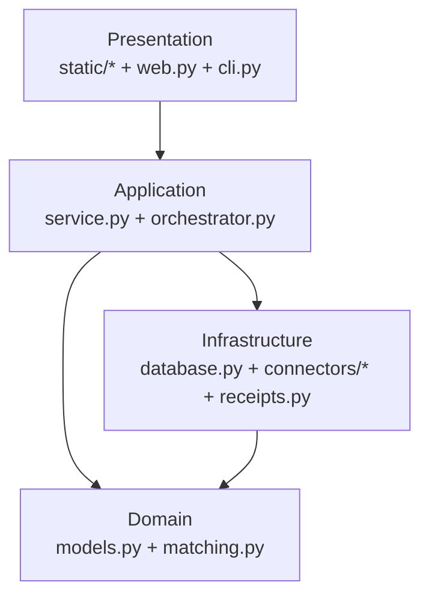
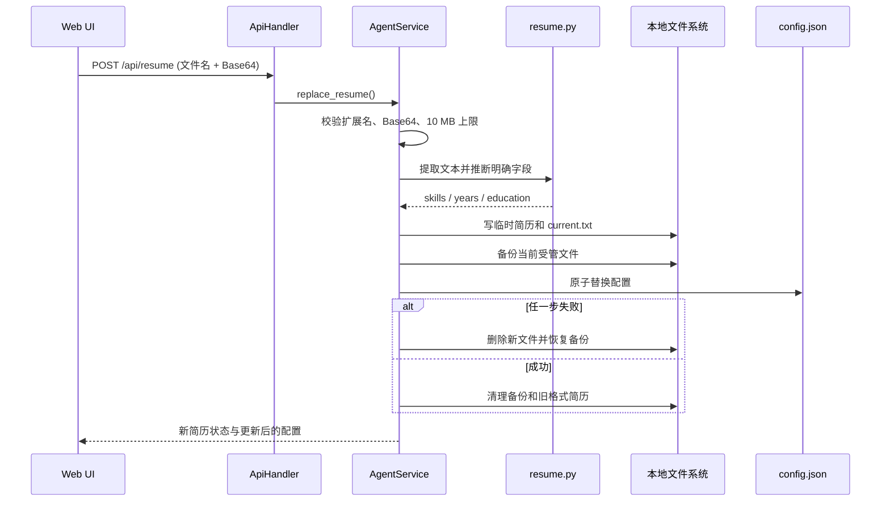
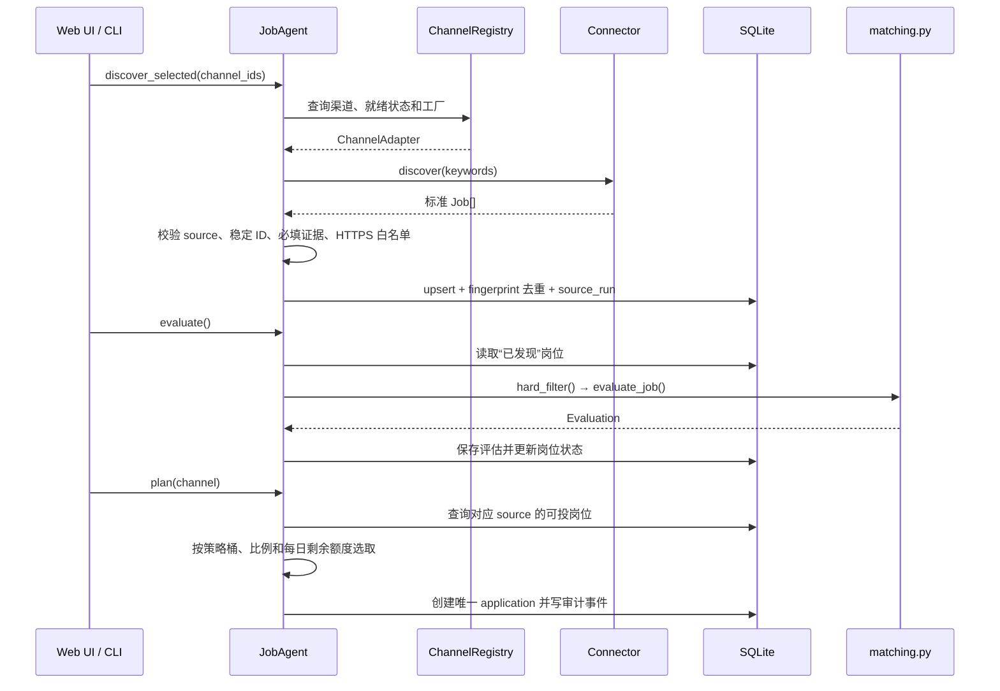
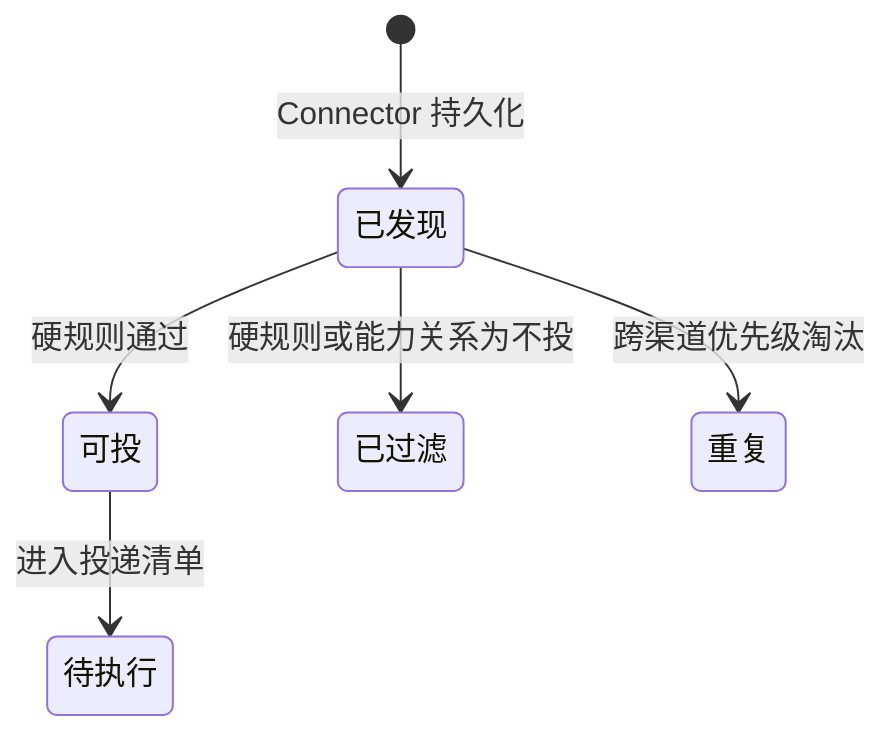
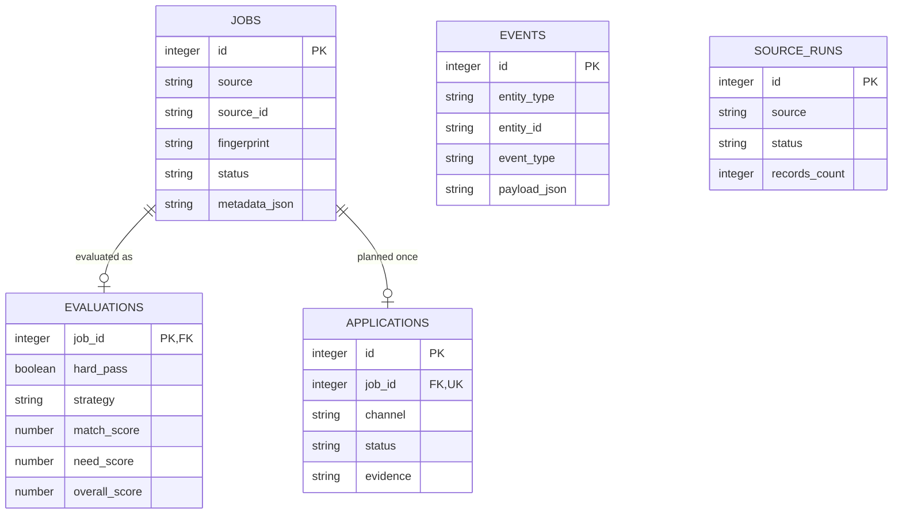

# 技术架构

本文描述当前仓库已经实现的技术架构、稳定边界和后续扩展约束。它回答“系统如何运行、数据如何流动、模块为什么这样拆、增加功能应接在哪里”。产品目标和需求优先级见 [产品需求文档](REQUIREMENTS.md)，具体文件修改入口和验证命令见 [维护手册](MAINTENANCE.md)，渠道协议细节见 [渠道适配指南](CHANNEL_ADAPTERS.md)。

## 1. 架构范围

当前系统是单用户、本地优先的求职工作台：

- Python 进程同时提供本地 HTTP API、静态页面和任务编排。
- 配置、简历、岗位、评估、投递台账和审计事件默认只保存在用户电脑。
- 招聘网站通过固定白名单 Connector 接入；入口页可访问不等于已获得真实岗位。
- 默认只把用户带到原始岗位页，由用户确认并完成最终提交。
- BOSS 浏览器操作、官网表单执行和 IMAP 回执属于源码实验能力；基础便携包不包含 Playwright/Chromium。
- LLM/BYOK、浏览器扩展、自动登录和验证码处理尚未实现，不属于当前架构的已交付能力。

### 当前能力与预留能力

| 能力 | 当前状态 | 架构边界 |
|---|---|---|
| PDF/DOCX 简历替换与本地解析 | 已实现 | `resume.py` + `AgentService.replace_resume()` |
| 固定渠道岗位发现 | 已实现 | `ChannelRegistry` + 各 Connector |
| 硬规则、双向规则评分和策略队列 | 已实现 | `matching.py` + `JobAgent.plan()` |
| SQLite 台账、渠道健康度和审计事件 | 已实现 | `database.py` |
| 最终官网跳转 | 已实现 | 前端读取岗位原始 URL |
| BOSS/官网真实写操作 | 实验性、默认关闭 | 显式 `live=true`；不确定结果转人工 |
| IMAP 回执识别 | 实验性、默认关闭 | `receipts.py`；密码只读环境变量 |
| LLM/BYOK 匹配 | 规划中 | 未来增加独立评分端口，不绕过硬规则 |
| 浏览器扩展自动填表 | 规划中 | `autofill.profile` 只是未来路由契约 |

## 2. 系统上下文



系统不依赖云端应用服务器。外部网络访问只发生在用户主动运行渠道发现、实验性执行或回执检查时。

## 3. 运行时与入口

### 源码运行

`pyproject.toml` 暴露两个命令：

- `job-agent` → `job_agent.cli:main`：初始化、采集、评估、规划、演练和诊断。
- `job-agent-desktop` → `job_agent.launcher:main`：选择本机可用端口、启动服务并打开默认浏览器。

### Windows 便携运行

PyInstaller 将 Python 运行时、静态页面、核心依赖和 `config.example.json` 打入 `JobAgent/`。首次启动在可执行文件旁创建：

```text
JobAgent/
├─ JobAgent.exe
├─ docs/
└─ data/
   ├─ config.json
   ├─ job-agent.sqlite3
   └─ resumes/
      ├─ current.pdf 或 current.docx
      └─ current.txt
```

基础 ZIP 不打包 Playwright 和 Chromium，因此浏览器型渠道会返回“运行时未就绪”，不能静默降级成假成功。

## 4. 分层与职责



| 层 | 组件 | 职责 | 不应承担 |
|---|---|---|---|
| 表现层 | `static/` | 向导、配置、岗位池、台账展示 | 站点解析、评分和数据库判断 |
| HTTP 层 | `web.py` | 路由、JSON 解析、错误响应、静态资源 | 业务规则和渠道特判 |
| 应用服务 | `service.py` | 配置/文件协调、简历原子替换、查询门面 | 招聘网站协议 |
| 编排层 | `orchestrator.py` | 采集、验证、持久化、评估、规划、执行、跟踪 | 解析具体站点 HTML/JSON |
| 领域层 | `models.py`、`matching.py` | 标准模型、硬规则、评分、策略配额 | 网络和文件 I/O |
| 渠道层 | `connectors/` | 外部协议、字段标准化、有限写操作 | 跨渠道排序和持久化 |
| 注册层 | `connectors/registry.py` | 渠道发现、就绪状态、工厂和能力声明 | 执行具体采集 |
| 持久层 | `database.py` | SQLite schema、查询、去重、台账、审计 | UI 展示逻辑 |
| 回执层 | `receipts.py` | 有界 IMAP 查询与回执证据提取 | 自动重投或猜测成功 |

依赖方向以“外层调用内层”为主。Connector 可以构造标准 `Job`，但 `matching.py` 不应反向依赖任何具体 Connector。

## 5. 核心业务流水线

### 5.1 简历替换



关键不变量：扫描版或不可读的新简历不能继续冒用上一份简历推断出的档案；识别不完整时必须显式标记 `resume_partial` 或 `manual_review`。

### 5.2 岗位发现、评估与规划



处理顺序固定为：

```text
真实岗位证据校验
  → 标准化
  → 同源幂等写入
  → 跨渠道指纹去重
  → 硬规则过滤
  → 人匹配岗位分
  → 岗位满足人分
  → 能力关系分类
  → 公司独立排序维度
  → 策略配额与每日额度
  → 投递清单
```

每日额度只约束最终清单数量，不参与“冲高 / 持平 / 保底 / 不投”的能力关系定义。

### 5.3 执行与投后跟踪

- `live=false` 是默认值，只写演练事件，不改变招聘网站状态。
- BOSS 使用专用多阶段协议：开场白成功后等待有效 HR 入站回复，之后才允许发送固定简历。
- 官网 Connector 没有实现可信 `submit()` 时返回 `needs_human` 和原始链接。
- 点击后缺少可验证成功证据时进入“结果待核验”，禁止自动重试。
- IMAP 只检查有时间窗口的近期邮件，并同时匹配公司/岗位身份与成功或拒绝语义。

## 6. 领域模型与状态

### 核心对象

| 对象 | 关键身份 | 用途 |
|---|---|---|
| `Candidate` | 单用户配置 | 简历路径、技能、年限、学历和档案来源 |
| `Job` | `(source, source_id)` | 标准化岗位及原始证据 |
| 跨渠道岗位 | `fingerprint(company,title,location)` | 发现同一岗位的多渠道副本 |
| `Evaluation` | `job_id` | 硬规则结果、双向分数、分类与解释 |
| Application | 唯一 `job_id` | 投递计划、执行状态和外部证据 |
| Event | `entity_type + entity_id` | 追加式审计记录 |
| SourceRun | `source + time` | 渠道最近一次真实运行健康度 |

### 岗位状态



模型还预留了“已过期”和“需人工”岗位状态，但当前主评估器会把已知过期岗位写为“已过滤”并在评估原因中保存截止日期证据；维护者不应把预留枚举误写成已经存在的状态迁移。

### 投递状态

投递状态包含 `待执行`、`已发开场白`、`等待HR回复`、`HR已有效回复`、`已发简历`、`官网已提交待回执`、`投递已确认`、`已拒绝`、`需要登录`、`需要人工处理`、`结果待核验`、`执行失败` 和 `已关闭`。

不同渠道不必经过所有状态，但状态只能由有证据的动作推进。暂时无邮件、页面超时或未知页面文案不能被当作失败后自动重投的依据。

## 7. 数据存储

SQLite 启用 WAL 和外键。当前关系如下：



约束：

- `jobs` 对 `(source, source_id)` 唯一，保证同一渠道重复采集幂等。
- `applications.job_id` 唯一，避免同一标准岗位进入多份投递清单。
- `evaluations.job_id` 与岗位一对一，重新评估覆盖旧结果。
- `events` 和 `source_runs` 是历史记录，不承担当前状态的唯一真相。
- schema 变更必须向前兼容；当前采用启动时检测字段并执行小型增量迁移。

## 8. 渠道扩展架构

### 注册项

`ChannelAdapter` 声明：

- 稳定 `id`、展示名和渠道类型；
- 是否启用、关键词、策略、每日额度；
- `connector_factory`；
- 允许域名集合；
- 成功状态和能力说明；
- 未就绪原因。

`ChannelRegistry` 从内置 provider 和 `job_agent.channels` Python entry point 加载注册项。单个第三方 provider 加载失败只记录为目录错误，不能阻止本地应用启动。

### Connector 最小协议

```python
class JobConnector(Protocol):
    source: str

    async def discover(self, keywords: list[str]) -> list[Job]: ...
    async def close(self) -> None: ...
```

可选 `submit()` 只决定执行能力。没有它的渠道仍可完成发现、评估、规划和人工跳转。

### 持久化前门禁

所有 Connector 返回值必须统一通过：

1. `job.source == ChannelAdapter.id`；
2. 具有稳定 `source_id`、岗位名、公司和详情 URL；
3. 详情页与申请页均为 HTTPS；
4. 跳转后的最终 host 仍在 `allowed_hosts`；
5. 记录来自真实岗位字段，不是 SPA 标题、加载壳或搜索入口。

普通新渠道不得在数据库或主编排器中增加公司 ID 特判。只有 BOSS 这类具有独立多阶段写协议的渠道才保留专用执行分支。

## 9. 本地 API

当前 API 是前端与应用服务之间的内部契约，不是公网 API：

| 方法 | 路径 | 用途 |
|---|---|---|
| GET | `/api/dashboard` | 汇总状态和渠道目录 |
| GET | `/api/jobs` | 岗位池 |
| GET | `/api/applications` | 投递台账 |
| GET | `/api/events` | 审计事件 |
| GET/PUT | `/api/config` | 读取或保存配置 |
| GET/POST | `/api/resume` | 当前简历状态或替换简历 |
| GET | `/api/channels` | 渠道就绪状态和健康度 |
| POST | `/api/demo/seed` | 导入离线演示岗位 |
| POST | `/api/run/discover` | 运行选定渠道采集 |
| POST | `/api/run/evaluate` | 运行硬规则和评分 |
| POST | `/api/run/plan`、`plan-all` | 生成投递清单 |
| POST | `/api/run/execute`、`execute-all` | 演练或显式真实执行 |
| POST | `/api/run/replies`、`send-resume` | BOSS 回复与简历阶段 |
| POST | `/api/run/receipts` | 检查官网邮件回执 |
| POST | `/api/run/cycle` | 组合运行主流程 |

错误响应保持 `{ "error": "...", "message": "..." }`。增加路由时，业务逻辑应先落在 `AgentService` 或 `JobAgent`，再由 `web.py` 做薄封装。

## 10. 配置与兼容性

`config.json` 是唯一配置真相，主要分为：

- `candidate`：候选人档案和受管简历路径；
- `preferences`：关键词、硬规则、策略、额度和渠道优先级；
- `greetings`：固定开场白模板；
- `fixed_answers`：用户明确提供的基础表单值；
- `boss`：BOSS 实验渠道设置；
- `official_sites`：固定官网/ATS 定义；
- `mail`：默认关闭的 IMAP 设置。

新增 dataclass 字段必须提供安全默认值，旧配置必须仍能读取。密钥、邮箱应用密码、Cookie 和 Token 不得进入示例配置；秘密只允许来自环境变量或未来的本地安全存储。

## 11. 安全与故障隔离

- HTTP 服务默认只绑定 `127.0.0.1` 且没有登录系统；不得在未增加认证和 CSRF 防护前绑定公网地址。
- 简历只接受 PDF/DOCX、最大 10 MB，并先解析再替换当前版本。
- 网络响应有超时、大小和数量上限；单渠道失败不抹掉其他渠道结果。
- 所有外链和 HTTP redirect 都经过 HTTPS 与 host 白名单复核。
- 登录、验证码、未知必填项、页面结构变化和不确定副作用统一停止自动流程。
- 真实写操作默认关闭、无自动重试，并必须保存证据或进入人工核验。
- `config.json`、`data/`、简历、数据库和浏览器状态均由 `.gitignore` 排除。

## 12. 未来扩展边界

### LLM 评分

未来模型能力应作为独立 `ScoringPort` 接在硬规则之后、规划之前：

```text
hard_filter(Job, Candidate, Preferences)
  → RuleScorer 或 LlmScorer
  → {match_score, need_score, confidence, reasons, evidence}
  → strategy allocation
```

要求：

- 始终分别输出“人匹配岗位”和“岗位满足人”，不能合并成不可解释的单分。
- LLM 失败时可回退规则评分；不能跳过硬规则。
- 提示词单独版本化并配结构化输出校验与测试 fixture。
- API Key 只从环境变量或本地安全存储读取。
- 模型输入最小化，不默认上传完整简历文件；UI 必须明确告知数据去向。

### 浏览器扩展

未来扩展建议放在仓库独立 `extension/` 目录，通过稳定的 `autofill.profile` 选择站点字段映射。扩展每次运行都要复核当前 URL、允许域名和字段可见性；开放题、未知必填项、验证码和最终提交按钮必须留给用户。

## 13. 测试与发布门禁

| 变化 | 最低验证 |
|---|---|
| 领域模型或规则 | 对应单元测试 + 全量离线测试 |
| 数据库 schema | 旧数据库迁移测试 + 新库测试 |
| 新渠道 | 离线解析/映射测试 + HTTPS 白名单测试 + 单渠道现场冒烟 |
| 简历链路 | 非法文件、同格式替换、跨格式替换、失败回滚 |
| 前端/API | 桌面、约 390 px、键盘、错误态和空结果 |
| 便携包 | 构建、首次启动、二次启动、数据保留和至少一个内置渠道冒烟 |

离线门禁：

```powershell
$env:PYTHONPATH='src'
.\.venv\Scripts\python.exe -m unittest discover -s tests -v
.\.venv\Scripts\python.exe -m compileall -q src tests
```

真实站点结果是时效性证据，不能固化成长期单元测试断言。Git tag `v*` 触发 Windows Actions 构建，Release ZIP 是发布产物，仓库源码始终是维护真相。

## 14. 架构不变量与已知技术债

### 不变量

1. 真实岗位证据先于评分。
2. 硬规则先于任何规则或模型软排序。
3. 能力关系、公司档位和每日额度彼此独立。
4. 渠道特例留在 Connector，通用流程只消费标准模型。
5. 不确定写操作不重试，状态推进必须有证据。
6. 本地数据不进入 Git，秘密不进入配置模板。

### 已知技术债

- `connectors/campus.py`、`orchestrator.py` 和 `static/app.js` 已经较大；继续增加渠道或执行协议时，应分别拆为站点模块、发现/规划/执行服务和前端功能模块。
- 数据库迁移目前是少量启动时增量 SQL；schema 复杂后应引入显式迁移版本表。
- 本地 HTTP API 没有认证，安全前提是默认 loopback 和单用户运行。
- `config.json` 与简历文件替换通过补偿回滚近似事务，不具备跨文件系统与 SQLite 的真正原子事务。
- 规则评分是当前实现；LLM、提示词版本、模型成本与隐私策略需要在实现前另做架构决策记录。

当以上不变量、外部系统、存储方式或主要模块边界发生变化时，应在同一提交中更新本文。
