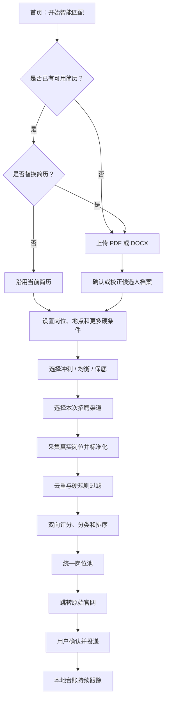

# 产品需求文档（PRD）

本文定义求职 Agent 的产品目标、目标用户、范围、功能需求、非功能要求和验收口径。它描述“为什么做、为谁做、必须解决什么问题”，不展开具体代码实现；技术实现见 [技术架构](ARCHITECTURE.md)，日常修改入口见 [维护手册](MAINTENANCE.md)。

## 1. 项目概述

### 1.1 一句话目标

在本地、可控、可解释的前提下，帮助求职者从固定招聘渠道获得真实岗位，先按个人硬条件过滤，再判断“人是否匹配岗位”和“岗位是否满足人的需要”，最终形成可执行、可追踪的投递清单。

### 1.2 要解决的核心问题

求职过程中最消耗时间、最容易重复劳动的环节主要有三个：

1. **岗位判断成本高**：不同官网岗位分散，用户需要反复搜索、阅读 JD、判断是否值得投递。
2. **投递信息重复填写**：姓名、联系方式、教育经历、简历等基础资料需要在不同官网重复录入。
3. **投递状态容易失控**：岗位来源、投递时间、当前阶段、面试或测评通知分散在网页和邮箱中。

项目最终希望覆盖“投前筛选 → 投递辅助 → 投后跟踪”三段流程。当前 Alpha 提供高推荐工作卡、全部岗位、官网跳转和人工求职进度；DeepSeek Judge 为可选评分能力，浏览器自动填表和更自动化的状态同步保留后续范围。

### 1.3 产品定位

本项目不是批量代投机器人，而是一个本地优先的求职决策与执行工作台：

- 帮用户减少无效岗位阅读，而不是盲目扩大投递量。
- 给出有证据、可解释的匹配结果，而不是只展示一个黑盒分数。
- 自动化确定且低风险的步骤，把最终提交、验证码、开放题等高风险动作留给用户。
- 允许用户从 GitHub 下载、解压运行，并能较低成本增加新渠道和新规则。

## 2. 目标用户与使用场景

### 2.1 主要用户

- 正在集中参加校招、实习招聘或社招的中文求职者。
- 同时关注多个公司官网，希望统一筛选和管理岗位的人。
- 愿意提供明确求职条件，但不希望把简历和个人数据长期上传到陌生平台的人。

### 2.2 次要用户

- 为自己或社区维护招聘渠道适配器的开发者。
- 希望研究本地 Agent、招聘数据标准化和可解释匹配流程的开源贡献者。

### 2.3 高频场景

1. **首次使用**：上传简历，填写目标岗位和地点，选择渠道，得到首批结果。
2. **再次使用**：沿用上次简历和条件，只修改关键词、地点、策略或本次渠道。
3. **替换简历**：上传新版 PDF/DOCX 覆盖本机旧版本，并重新建立候选人档案。
4. **查看岗位**：在智能推荐中逐张核对高推荐岗位；在全部岗位中搜索不同推荐度的机会，跳转官网查看或投递。
5. **持续跟踪**：在求职进度中记录实际投递、沟通、测评、面试等阶段和备注；准备投递与已投递明确区分。
6. **维护岗位情报**：把一篇可追溯的牛客或小红书岗位经历导入本地情报库，查看准入、主题块和来源覆盖。

## 3. 产品目标

### OBJ-01：减少岗位筛选时间

从多个固定渠道采集具有稳定岗位 ID、标题、公司、地点、JD 和详情链接的真实岗位，统一展示并去重，避免用户反复访问多个官网搜索同一类岗位。

### OBJ-02：提升岗位判断质量

先执行职位、地点、薪资、学历、经验等硬规则，再分别计算：

- **人匹配岗位**：候选人的技能、经验和方向是否满足岗位要求。
- **岗位满足人**：地点、薪资、工作方式、公司偏好和时效性是否符合用户需要。

对通过硬规则的岗位，可检索同岗位族的职责、技能和面试证据，以及同公司同岗位族的强度、薪酬、文化、成长、稳定性和办公方式证据，补足 JD 信息缺口。结果必须展示分类、分数、缺口、原因和可回查来源，不能把单篇社区经历、公司名气、每日额度或单一总分当作能力关系。

### OBJ-03：形成可执行的投递组合

支持冲刺、均衡、保底三种投递模式：

- 冲刺：提高“岗位满足人”的排序权重，并增加冲高岗位配额。
- 均衡：平衡“人匹配岗位”和“岗位满足人”。
- 保底：提高“人匹配岗位”的排序权重，并增加保底岗位配额。

策略只能影响通过硬规则后的排序和配额，不能让不符合硬条件的岗位进入清单。

### OBJ-04：降低重复填写和投递管理成本

复用用户明确提供的结构化基础信息，为未来浏览器扩展自动填表建立稳定契约；当前阶段提供原始官网跳转和本地台账，不替用户处理验证码、开放题或最终提交。

### OBJ-05：保证隐私、安全和可维护性

简历、配置、数据库和投递记录默认保存在本机。渠道通过注册表扩展，站点特例集中在 Connector，保证后续增加渠道、筛选字段、模型或插件时不需要重写主流程。

## 4. 非目标

以下事项不属于当前产品承诺：

- 自动适配互联网上任意招聘网站。
- 绕过登录、验证码、限速、风控或平台规则。
- 未经确认替用户批量点击最终提交。
- 自动编造项目经历、开放题答案、求职信或简历事实。
- 为每个岗位自动改写一份不同简历。
- 把搜索入口、加载壳、公司介绍或无法验证的摘要伪装成岗位。
- 在未实现前宣称已支持 LLM、BYOK、自动填表或完整邮件同步。

## 5. 版本范围

| 阶段 | 范围 | 状态 |
|---|---|---|
| Alpha / P0 | 本地运行、简历管理、固定渠道采集、硬规则、规则评分、岗位情报准入/切块/检索、策略清单、岗位跳转、SQLite 台账 | 已实现 |
| P1 | DeepSeek BYOK 双向评分、人工求职阶段与备注、浏览器扩展基础字段填充 | DeepSeek Judge、人工进度已实现；浏览器扩展规划中 |
| P2 | 可靠的招聘邮件事件识别、更多 ATS、插件字段模板市场、可选本地模型 | 规划中 |

规划能力只有在实现、测试和真实页面验收后才能从“规划中”改为“已实现”。

## 6. 用户主流程

## 7. 功能需求

### 7.1 本地启动与数据初始化

| 编号 | 需求 | 优先级 | 当前状态 |
|---|---|---|---|
| FR-START-01 | Windows 用户下载便携 ZIP 后可解压并双击运行，无需单独安装 Python | P0 | 已实现 |
| FR-START-02 | 首次启动自动创建本地配置和数据库，后续启动继续使用原数据 | P0 | 已实现 |
| FR-START-03 | 默认只监听本机回环地址，并自动打开本地控制台 | P0 | 已实现 |
| FR-START-04 | 端口被占用时选择后续可用端口，不覆盖用户数据 | P0 | 已实现 |

### 7.2 简历与候选人档案

| 编号 | 需求 | 验收口径 | 优先级 |
|---|---|---|---|
| FR-RES-01 | 首次任务必须有可用简历 | 支持 PDF/DOCX；最大 10 MB；无简历时不能直接进入采集 | P0 |
| FR-RES-02 | 再次任务允许沿用简历 | 上传入口始终保留，但新文件不是必填项 | P0 |
| FR-RES-03 | 允许覆盖旧简历 | 新文件验证和解析成功后才替换；失败恢复旧版本 | P0 |
| FR-RES-04 | 从可读文本建立初始档案 | 只写入明确识别出的技能、工作年限和学历 | P0 |
| FR-RES-05 | 允许用户手动校正档案 | 手动值成为当前评分依据，并标记来源 | P0 |
| FR-RES-06 | 不可读新简历不得复用旧推断 | 扫描版或空文本进入人工校正状态 | P0 |

### 7.3 岗位条件

岗位名称和地点是主流程中的核心字段；其他条件放在“更多硬性条件”中，并允许沿用上次值。

| 条件 | 行为 |
|---|---|
| 目标岗位名称 | 岗位标题未命中时直接过滤 |
| 可接受地点 | 岗位地点未命中时直接过滤 |
| 职位类型 | 全职、实习、校招、兼职；已披露但不匹配时过滤 |
| 办公方式 | 现场、混合、远程；已披露但不匹配时过滤 |
| 最低薪资 | 已披露的薪资上限仍低于期望时过滤 |
| 学历 | 候选人学历明确低于岗位要求时过滤 |
| 经验差距 | 岗位最低经验超过用户年限与允许差距时过滤 |
| 发布时间 | 超过用户允许天数时过滤 |
| 截止日期 | 已明确过期时过滤 |
| 排除关键词 | 标题、公司或 JD 命中时过滤 |
| 公司黑名单/不投档 | 命中时直接过滤 |
| 未知字段策略 | `keep` 保留未知字段；`reject` 对受支持的未知硬字段保守过滤 |

### 7.4 渠道配置与岗位采集

| 编号 | 需求 | 优先级 | 当前状态 |
|---|---|---|---|
| FR-CH-01 | 长期渠道配置和本次渠道选择分离 | P0 | 已实现 |
| FR-CH-02 | 页面显示渠道启用、就绪、能力和最近健康状态 | P0 | 已实现 |
| FR-CH-03 | 所选渠道逐个独立运行，单渠道失败不阻断其他渠道 | P0 | 已实现 |
| FR-CH-04 | 只接收带稳定 ID、公司、岗位名和详情链接的真实岗位 | P0 | 已实现 |
| FR-CH-05 | 所有详情页和申请页必须通过 HTTPS host 白名单 | P0 | 已实现 |
| FR-CH-06 | 内置美团、滴滴、快手、腾讯、京东校招官网 | P0 | 已实现 |
| FR-CH-07 | 新普通渠道通过配置或注册表扩展，不修改数据库主流程 | P0 | 已实现 |
| FR-CH-08 | BOSS 浏览器发现与沟通作为可选源码实验能力 | P1 | 实验性 |

### 7.5 标准化、去重与时效

| 编号 | 需求 | 验收口径 | 优先级 |
|---|---|---|---|
| FR-JOB-01 | 不同渠道统一为同一岗位模型 | 保留来源、稳定 ID、标题、公司、地点、JD、原始 URL 和已知硬字段 | P0 |
| FR-JOB-02 | 同源重复采集幂等 | `(source, source_id)` 不产生重复记录 | P0 |
| FR-JOB-03 | 跨渠道识别重复岗位 | 使用公司、岗位、地点指纹并按渠道优先级保留 | P0 |
| FR-JOB-04 | 已进入投递流程的岗位不可被后来副本替换 | 保持 application 与原岗位证据一致 | P0 |
| FR-JOB-05 | SPA 详情链接保持可定位到具体岗位 | 不删除必要 URL fragment | P0 |

### 7.6 岗位情报与 RAG

| 编号 | 需求 | 验收口径 | 优先级 / 状态 |
|---|---|---|---|
| FR-RAG-01 | 首批范围为腾讯、阿里、美团、快手、百度和产品/数据/算法/后端岗位族 | 公司和岗位别名从配置读取，通用代码不写公司 ID 分支 | P0 / 已实现 |
| FR-RAG-02 | 只有可追溯、范围明确、包含决策事实且仍有时效的帖子进入向量库 | accepted/review/rejected/duplicate 原因可查看；只有 accepted 有证据块 | P0 / 已实现 |
| FR-RAG-03 | 一篇帖子作为一个父文档，按单一决策主题生成子块 | 子块保留父文档、URL、主题、原文偏移和上下文前缀；不机械重叠 | P0 / 已实现 |
| FR-RAG-04 | 能力证据和需求证据分开检索 | 能力侧只取职责/技能/面试；需求侧只取同公司同岗位族的岗位体验；两侧与岗位用工类型一致 | P0 / 已实现 |
| FR-RAG-05 | 社区证据不能覆盖硬规则 | 任一硬规则失败时不检索；加入任意帖子都不能翻转硬拒绝 | P0 / 已实现 |
| FR-RAG-06 | 小红书不直接爬取 | 只接受人工或登录后当前可见正文，不接收 Cookie/Token/密码 | P0 / 已实现 |
| FR-RAG-07 | 牛客只做单篇公开页有界读取 | 用户给出 `/discuss/<id>`；限速、超时、大小上限、无搜索/翻页/重试，遇 403/429/验证码停止 | P0 / 已实现 |
| FR-RAG-08 | 默认最小化保存社区正文 | 向量化前脱敏；默认不存整篇原文，只存决策块、哈希和必要元数据 | P0 / 已实现 |
| FR-RAG-09 | embedding、来源和评分器可替换 | 通过 Protocol/注册表注入，知识表不改原岗位与投递 schema | P0 / 已实现 |
| FR-RAG-10 | RAG 证据参与模型双向判断并逐条引用 | DeepSeek 结构化输出引用块 ID，冲突和证据不足显式表达，失败回退规则评分 | P1 / 已实现 |
| FR-RAG-11 | 正职与实习严格隔离 | 文档必须唯一标记类型；切片、候选查询、证据包和 Judge 引用都不得跨类型回退 | P0 / 已实现 |
| FR-RAG-12 | 社区体验只相对用户明确偏好判断 | 配置可记录强度、职责边界、成长、稳定性、文化和风险取向；未填写时 Judge 不自行定义好坏 | P1 / 已实现 |

详细准入、切分、检索权重、语料配额和评测门禁见 [岗位情报 RAG 规范](RAG_KNOWLEDGE.md)。

### 7.7 匹配、解释与策略

| 编号 | 需求 | 验收口径 | 优先级 |
|---|---|---|---|
| FR-MATCH-01 | 硬规则先于软评分 | 任一硬规则失败即为“不投” | P0 |
| FR-MATCH-02 | 分开计算人岗匹配分和岗位满足分 | 两个 0–100 分数独立保存和展示 | P0 |
| FR-MATCH-03 | 能力关系只有冲高、持平、保底、不投 | “不投”是过滤结果，不是第四种投递模式 | P0 |
| FR-MATCH-04 | 公司档位独立于能力关系 | 大公司不能自动等于冲高 | P0 |
| FR-MATCH-05 | 三种投递模式改变排序权重 | 冲刺 35%/65%，均衡 50%/50%，保底 65%/35% | P0 |
| FR-MATCH-06 | 三种模式同时改变清单配额 | 在每日额度内按冲高/持平/保底比例选取 | P0 |
| FR-MATCH-07 | 每个结果提供理由 | 显示硬规则原因、已匹配能力、能力缺口、双向分数和置信度 | P0 |
| FR-MATCH-08 | 支持用户选择官方模型或自带 API | 模型输出结构化双向分数；失败可回退规则模式 | P1，规划中 |
| FR-MATCH-09 | 内置提示词版本化 | 提示词可测试、可回滚，不散落在业务代码 | P1，规划中 |

### 7.8 岗位池与用户决策

| 编号 | 需求 | 优先级 | 当前状态 |
|---|---|---|---|
| FR-POOL-01 | 全部岗位保留所有已收录结果与来源，包括高推荐、待核实、低推荐和未评估岗位 | P0 | 已实现 |
| FR-POOL-02 | 用户可查看分类、分数、公司、地点和匹配理由 | P0 | 已实现 |
| FR-POOL-03 | 每个岗位提供原始详情或申请页跳转 | P0 | 已实现 |
| FR-POOL-04 | 无结果、无渠道、渠道未就绪和单渠道失败都有明确提示 | P0 | 已实现 |
| FR-POOL-05 | 用户可搜索和按状态查看岗位 | P0 | 已实现 |

### 7.9 投递辅助

| 编号 | 需求 | 优先级 | 当前状态 |
|---|---|---|---|
| FR-APPLY-01 | 默认由用户在原始官网完成最终提交 | P0 | 已实现 |
| FR-APPLY-02 | 复用用户明确填写的姓名、电话、邮箱等固定信息 | P0 | 已预留数据结构 |
| FR-APPLY-03 | 提供浏览器扩展自动填写已知基础字段 | P1 | 规划中 |
| FR-APPLY-04 | 未知必填项、开放题、验证码和最终提交必须转人工 | P0 | 已定义边界 |
| FR-APPLY-05 | 不确定写操作不得自动重试 | P0 | 已实现 |
| FR-APPLY-06 | BOSS 遵循“固定开场白 → HR 有效回复 → 固定简历” | P1 | 源码实验性 |

### 7.10 投后跟踪

| 编号 | 需求 | 优先级 | 当前状态 |
|---|---|---|---|
| FR-TRACK-01 | 每个进入清单的岗位只创建一条投递记录 | P0 | 已实现 |
| FR-TRACK-02 | 保存当前状态、时间、证据、错误和外部 ID | P0 | 已实现 |
| FR-TRACK-03 | 保存岗位、渠道和应用的重要审计事件 | P0 | 已实现 |
| FR-TRACK-04 | 求职进度支持八个手工阶段、最多 2000 字备注和筛选；与旧执行状态独立 | P1 | 已实现 |
| FR-TRACK-05 | 从招聘邮件识别投递成功、测评、面试或拒绝事件 | P1 | IMAP 实验性 |
| FR-TRACK-06 | 邮件必须按公司/岗位身份与时间窗口关联 | P1 | 已定义规则，待完整产品化 |
| FR-TRACK-07 | 官网直接状态同步只在有稳定公开接口时接入 | P2 | 规划中 |

## 8. 非功能需求

### 8.1 隐私

- 默认不上传简历到项目自有服务器，因为项目不依赖自有云服务。
- 社区帖子默认不保存整篇原文；先脱敏再保存决策块，并允许用户删除父文档及全部子块。
- 本机 `config.json`、简历、数据库、Cookie、Token 和邮箱密码不得提交到 Git。
- 接入外部模型前必须说明会发送哪些字段，并允许用户选择不用模型。
- 不收集遥测；未来如增加必须默认关闭并单独征得同意。

### 8.2 安全

- 默认仅监听 `127.0.0.1`；在没有认证和 CSRF 防护前不得暴露到公网。
- 所有渠道必须配置允许域名，并校验 HTTP redirect 后的最终地址。
- 不接收账号密码，不尝试破解验证码。
- 不用自动搜索、翻页、重试或复用登录凭证规避小红书、牛客的访问控制。
- 真实写动作默认关闭，必须由用户显式确认。

### 8.3 可靠性

- 配置保存和简历替换失败时不得留下半写入文件。
- 单渠道异常不能删除其他渠道已有岗位。
- HTTP 200、页面标题或加载壳不能当作岗位采集成功。
- 知识来源失败、证据不足或 embedding 不可用时回退原规则链，不抹掉岗位结果。
- 不确定提交结果进入“结果待核验”，不能自动重复投递。

### 8.4 可用性与无障碍

- 首次用户能沿着单一向导完成简历、条件、策略、渠道和结果查看。
- 再次使用不强迫重复上传简历或填写全部条件。
- 关键流程支持键盘操作和明确焦点。
- 页面在桌面与约 390 px 移动宽度下可操作。
- 状态不能只依靠颜色表达，错误信息必须说明下一步动作。

### 8.5 兼容性与可维护性

- 源码支持 Python 3.11 及以上。
- Windows 10/11 x64 提供便携发布包。
- 新配置字段提供默认值，旧配置和旧数据库可以向前迁移。
- 新硬规则、新渠道和数据迁移必须有离线测试。
- 招聘站点现场测试与不联网的单元测试分开管理。

## 9. 产品成功口径

当前项目不收集在线用户数据，因此成功口径分为可自动验证的质量指标和需要用户研究验证的体验目标。

### 9.1 可自动验证指标

- 可进入岗位池的记录 100% 具有稳定来源、岗位 ID、公司、标题和 HTTPS 详情链接。
- 越过渠道域名白名单的岗位进入岗位池数量为 0。
- 同一 `(source, source_id)` 不产生重复岗位。
- 同一岗位只产生一条 application。
- 硬条件失败的岗位进入投递清单数量为 0。
- 硬条件失败的岗位触发社区证据检索数量为 0。
- `needs_review`、`rejected` 和 `duplicate` 文档生成向量块数量为 0。
- 单渠道失败时，其他正常渠道仍可完成。
- 离线测试和便携构建在 GitHub Actions 中通过。

### 9.2 用户体验目标

- 用户能理解岗位为什么被保留或过滤。
- 用户再次使用时能直接沿用简历和条件开始任务。
- 用户能分辨“渠道异常”“没有匹配岗位”和“岗位被硬规则过滤”。
- 用户能从岗位发现一直追溯到原始官网和投递台账。
- 用户能区分 JD 事实、社区经历和模型推断，并回到每篇原帖核对。
- 自动化不会让用户担心重复提交或未经确认发送个人信息。

## 10. 异常与降级要求

| 场景 | 产品行为 |
|---|---|
| 没有可用简历 | 停留在简历步骤并要求上传或修复路径 |
| 简历无法解析文本 | 保留文件，提示人工校正；不得复用旧推断档案 |
| 没有选择渠道 | 返回可操作提示，不显示伪成功 |
| 渠道配置不完整 | 展示缺失字段和未就绪原因 |
| 某渠道请求失败 | 记录渠道健康状态，继续其他渠道 |
| 渠道只返回入口或加载壳 | 标记未解析，不生成假岗位 |
| 小红书链接需要登录 | 不直接抓取，提示用户导入当前可见的单篇正文 |
| 牛客返回 403/429、验证码或页面壳 | 立即停止且不重试，记录访问限制状态 |
| 帖子缺少发布时间 | 标记待复核，不生成向量；用户明确复核后才能入库 |
| 岗位情报检索失败或无覆盖 | 保留原规则评分，证据覆盖标记不足 |
| 岗位关键字段缺失 | 持久化前拒绝该批次或该记录 |
| 真实写动作需要登录/验证码 | 停止并交给用户 |
| 提交后无成功证据 | 标记结果待核验，不重试 |
| 邮件无法明确关联岗位 | 不自动更新该岗位状态 |
| LLM 不可用或返回非法结构 | 回退规则评分并说明模型未参与 |

## 11. 发布验收

一个版本只有同时满足以下条件，才能标记对应能力“已实现”：

1. 需求编号、实现、测试和用户文案一致。
2. 不把规划、实验性或未现场验证的能力写成稳定功能。
3. 离线测试和编译检查通过。
4. 涉及前端时完成桌面、移动宽度、键盘和错误态验证。
5. 涉及招聘渠道时完成单渠道真实岗位冒烟，并记录验证日期。
6. 涉及写操作时验证成功证据、失败状态和禁止重试边界。
7. 涉及岗位情报时验证准入状态、父子溯源、能力/需求隔离、反爬停止状态和硬规则守恒。
8. 涉及便携包时验证首次启动、二次启动、本地数据保留和依赖边界。
9. 同步更新本文、技术架构、维护手册和 Release 说明中的能力状态。

## 12. 后续需求决策

进入 P1 开发前仍需单独确认：

1. 官方 LLM 的提供方式、成本控制、隐私告知和默认模型。
2. BYOK 支持哪些 OpenAI-compatible 提供商，以及密钥的本地保存方式。
3. 首个生产 embedding 提供方、重建索引方式和黄金集门槛。
4. 浏览器扩展与本地服务之间的通信、权限和用户确认机制。
5. 自动填表第一批支持的官网、字段清单和验收页面。
6. 当前手工阶段与执行证据独立保留；未来邮箱回执或官网状态与人工记录冲突时的处理规则仍需确认。
7. 是否需要本地通知、待办提醒和结果导出。

这些决策未完成前，维护者可以预留接口，但不能在页面上承诺相应能力已经可用。

## 13. 智能推荐工作卡（2026-10-12）

- 默认进入智能推荐，仅展示当前 `decision.status=recommend` 的高推荐岗位。每次呈现一张卡，两侧箭头切换；高推荐沿用当前事实/偏好规则，不采用综合分大于某个阈值的定义。无高推荐结果时不补入低推荐岗位。
- 全部岗位保留完整岗位列表和推荐度标识；求职进度记录已经选择或投递的岗位；我的档案管理简历及偏好。设置为低频入口，情报库、运行统计、运行记录与实验执行工具位于高级区，不与主页面争夺导航位置。
- 工作卡展示岗位身份、可投性、能力匹配、薪资口径、值得了解的理由、风险及待确认信息；不因单卡布局删除原有决策点。
- 六组体验固定出现：时间负担、工作节奏、职责质量、管理文化、成长性、稳定性。有适用事实时在卡片首层展示摘录；没有数据时显示待核实。
- 展开区展示固定薪资、发薪月数、奖金、股权、福利、五险一金、试用期、加班费、签字费及不可计算的年现金/总包/时薪；没有完整口径不生成估算。
- 理由与风险可以点击依据，展开并聚焦对应证据；每条证据保留原文或规则核对标记、来源、链接、日期和公司/岗位族/用工/团队/城市作用域。个人样本和背景参考不冒充本岗位承诺。
- 当前档案与偏好每次重新核对，明确学历硬门槛、过期和重复不进入默认推荐；软优先条件、ATS未验证、学历或用工未知保留待核实。未披露工时、薪资或高优先级体验时不能强推荐。
- 支持搜索、同团队体验样本筛选与清除；箭头明确标示上一张/下一张及边界禁用态，卡片序号由状态区宣读。左右键只在轮播区域非文本输入场景生效，不全局接管键盘；筛选、刷新或删除数据时保持有效卡片与焦点。
- 全部岗位保留“一键投递 · 未开放”禁用入口。本轮新增的进度 API 只保存本机记录，不调用现有真实投递执行器。
- 推荐接口为本机只读事实/规则整理，不调用付费模型、不抓外网、不写检索或投递状态。AI评估仍是独立已有可选功能，不把规则推荐宣传为大模型结论。
- 界面采用用户确认的深海蓝＋冷灰白及卡片与勾的几何品牌图标；减少重复宣传文案，保留风险、未知、来源限制和错误恢复提示。

## 14. 求职进度（v0.3.0-alpha）

- 用户可从卡片、全部岗位或求职进度中选择已有岗位，创建或更新同一条本地记录；同一岗位不会产生多条 application。
- 可编辑阶段为准备投递、沟通中、提交待确认、已投递、测评、面试、Offer、已结束；备注最多 2000 字，保存在本机。
- 旧记录按执行状态生成保守的显示阶段；未确认、执行失败或需要人工的记录显示待确认，不冒充已投递。
- 手工阶段、备注、更新时间和来源与原 `status`、外部 ID、执行时间及成功/异常证据独立保存；手工记录不表示平台确认，也不授权发送或提交。
- 手工维护记录不得继续被实验执行器、自动发简历或回执推进流程消费。已在途的真实操作产生的证据仍须保存，但不能覆盖手工阶段和备注。
- 阶段与岗位搜索、编辑后刷新、重启保留、旧数据库迁移、无记录和保存失败均属于验收范围；保存失败时保留输入并显示可重试错误。
